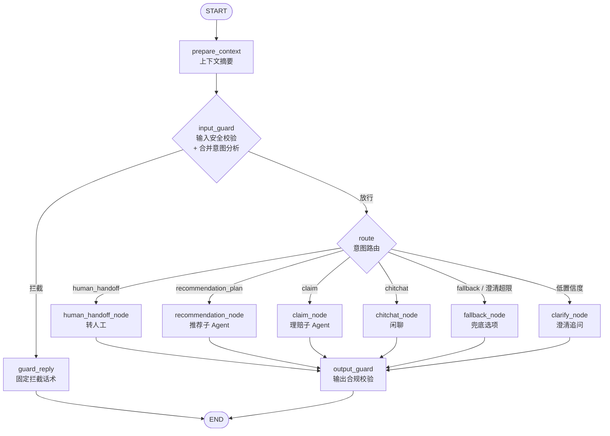
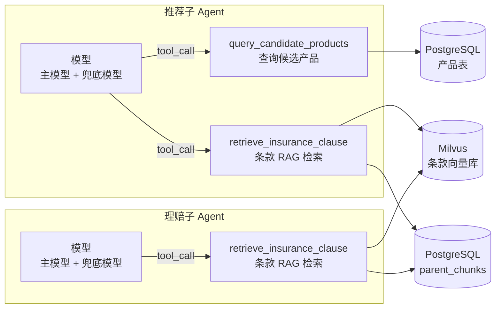

# LangGraph 架构与主图

> 对应代码：`app/agents/orchestration/graph.py`
> 说明：`input_guard` 和 `route` 使用 `Command(goto=...)` 动态跳转，下图按逻辑跳转关系绘制。

## 1. 主图

## 2. 子 Agent 与工具

## 3. 节点职责

| 节点 | 职责 |
|---|---|
| `prepare_context` | 历史消息超过阈值时摘要压缩，保留最近消息 |
| `input_guard` | 输入安全校验；L0/L1 未命中时合并做 L2 意图分类 |
| `guard_reply` | 输入被拦截时返回固定安全话术 |
| `route` | 按 L0 → L1 → L2 → 关键词兜底识别意图，并决定跳转节点 |
| `clarify_node` | 低置信度或信息不足时追问，最多连续 2 轮 |
| `recommendation_node` | 推荐子 Agent：查候选产品 + 查条款 + 生成方案 |
| `claim_node` | 理赔子 Agent：查条款 + 说明流程/材料/责任 |
| `chitchat_node` | 简短闲聊并引导回保险业务 |
| `human_handoff_node` | 设置 `handoff_requested`，返回转人工话术 |
| `fallback_node` | 给出可选项，让用户换说法或主动转人工 |
| `output_guard` | 输出合规校验；命中风险时用同 id 消息原位替换 |
| `END` | 本轮结束，runner 写 `answer_completed` 并推送 SSE |

## 4. 关键设计

1. **动态边**：`input_guard` 和 `route` 返回 `Command(update=..., goto=...)`，不需要额外的条件边函数。
2. **统一出口**：所有工作流节点和澄清节点都经过 `output_guard`，保证用户看到的内容都经过输出合规校验。
3. **拦截短路**：输入被拦截时直接走 `guard_reply`，不进入意图路由和工作流。
4. **转人工与兜底分离**：`human_handoff_node` 只处理明确转人工；`fallback_node` 不自动转人工，先给用户可选方向。
5. **子 Agent 工具隔离**：推荐子 Agent 可查产品和条款；理赔子 Agent 只挂条款检索工具。
